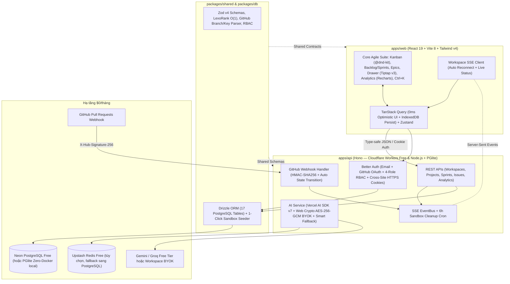

# TaskManager — AI-First Agile PM Platform

Nền tảng quản lý dự án **AI-First Agile PM** dành cho đội ngũ kỹ thuật (Sprint, Backlog, Epics Roadmap, O(1) LexoRank Kanban, Burndown/Velocity Analytics, GitHub Smart PR Automation & 3 Trụ cột AI Copilot).

Dự án được xây dựng theo kiến trúc **TypeScript Monorepo** sẵn sàng mở rộng thương mại (**Zero-Refactor** từ MVP Portfolio **\$0/tháng** lên SaaS Production) với **17 bảng PostgreSQL**, **0ms Optimistic UI**, **Edge Runtime** và kiểm thử toàn diện bằng **Vitest + Playwright Full-Stack E2E**.

---

## Kiến trúc Hệ thống Tổng thể



---

## 6 Điểm nhấn Kỹ thuật (Case Study Senior/Fullstack)

1. **Agile-Native Unified Graph & Semantic Workflow States (17 bảng PostgreSQL)**
   - Mọi dự án có thể tùy biến thêm/sửa/xóa cột Kanban (có giới hạn WIP Limit riêng), nhưng mỗi cột luôn ánh xạ về 1 trong 5 nhóm ngữ nghĩa chuẩn: `backlog`, `unstarted`, `started`, `completed`, `canceled`. Nhờ vậy biểu đồ Burndown, Velocity, GitHub Auto-Transition và AI Risk Radar hoạt động đồng nhất bất kể người dùng đặt tên cột là gì.
2. **Fractional Indexing Base-62 (Kéo thả O(1) LexoRank)**
   - Thứ tự thẻ và cột dùng chuỗi phân đoạn Base-62 ([`lexorank.ts`](packages/shared/src/lexorank.ts)). Khi kéo-thả giữa hai thẻ bất kỳ, backend chỉ `UPDATE` **đúng 1 dòng dữ liệu duy nhất** thay vì re-index toàn bộ danh sách.
3. **Immutable `activity_logs` nuôi Burndown Chart & AI Sprint Risk Radar**
   - Mọi biến động trạng thái, Sprint, Story Points hay PR đều ghi nhận bất biến trong `activity_logs`. Thuật toán Analytics tái dựng chính xác đường Burndown từng ngày, tính Velocity lịch sử và phát hiện sớm các Issue bị "kẹt" (`> 72 giờ` ở trạng thái `started`), quá hạn hoặc cột vượt ngưỡng WIP.
4. **0ms Optimistic UI + Lazy Code-Splitting + Realtime SSE Đa Tab**
   - Thao tác kéo-thả cập nhật cache TanStack Query tức thì trước khi server phản hồi (tự rollback khi gặp lỗi quyền 403) và lưu bền vào IndexedDB (`idb-keyval`).
   - Các module nặng như [`IssueDetailDrawer`](apps/web/src/features/issues/IssueDetailDrawer.tsx) (Tiptap v3 + ProseMirror) và [`AnalyticsDashboard`](apps/web/src/features/analytics/AnalyticsDashboard.tsx) (Recharts) được tách chunk lazy-load khỏi bundle khởi tạo chính.
   - Kênh `EventSource` SSE tự kết nối lại theo exponential backoff và đồng bộ tức thì giữa nhiều tab/thành viên với badge trạng thái `Live`.
5. **AI Copilot Hybrid Free-Tier + BYOK Vault (`AES-256-GCM`)**
   - Dùng Vercel AI SDK v7 kèm `Output.object({ schema })` (Zod v4) cho cả 5 nhà cung cấp (`gemini`, `groq`, `openai`, `anthropic`, `openrouter`), đi kèm **Smart Deterministic Fallback** tiếng Việt/Anh đảm bảo bản Demo chạy trọn vẹn ngay cả khi chưa nhập API Key.
   - Rate-limit 15 lượt/ngày qua Upstash Redis (tự động fallback đếm qua bảng `ai_usage_logs` trên PostgreSQL). Admin/Owner có thể nhập API Key riêng mã hóa chuẩn **Web Crypto `AES-256-GCM`** để mở khóa không giới hạn.
6. **Edge-First Dual Runtime & Zero-Docker Developer Experience**
   - Cùng một ứng dụng Hono chạy mượt trên **Cloudflare Workers** (`worker.ts`, kèm Cron `0 */6 * * *` tự dọn Sandbox hết hạn sau 24 giờ) và **Node.js** (`server.ts`, tự động khởi động **PGlite PostgreSQL nhúng** khi không có Docker/Neon).

---

## Tính năng Đầy đủ Đã Triển khai

| Phân hệ | Tính năng chi tiết |
| :--- | :--- |
| **Auth, RBAC & Sandbox** | Better Auth (Email + GitHub OAuth), 4 vai trò (`owner > admin > member > viewer`), cookie HTTPS cross-site cho Pages ↔ Workers, **1-Click Demo Sandbox** (dữ liệu 18 issues, 3 Epics, 3 Sprints, 6 ngày Burndown, PR links) |
| **Core Agile Workspace** | **Active Sprint Board** (`@dnd-kit` LexoRank + cảnh báo vượt WIP Limit), **Backlog & Sprint Planning** (kéo/chuyển Sprint, Complete Sprint tự cuộn issue dở dang), **Epics Roadmap**, **Command Palette (`Ctrl+K`)** |
| **Deep Issue Drawer** | Trình soạn thảo Markdown **Tiptap v3**, Sub-issues inline, Issue Relations (`blocks` / `blocked_by` / `relates_to` / `duplicates`), Comments hỗ trợ `@mention` autocomplete & xóa theo RBAC, dòng thời gian Activity Log, nút 1-click **Copy Git Branch** |
| **3 Trụ cột AI Copilot** | 1) **PRD-to-Backlog**: dán PRD → tạo hàng loạt Epic + Issues + Relations trong 1 transaction; 2) **AI Sprint Risk Radar**: chấm điểm rủi ro 0–100 & khuyến nghị Daily Standup; 3) **Natural Language Filter**: gõ tiếng Việt/Anh thay JQL để lọc trực tiếp Board/Backlog |
| **Analytics & GitHub Sync** | Biểu đồ **Sprint Burndown**, **Team Velocity**, **Workload** từng thành viên; **GitHub PR Webhook** (`X-Hub-Signature-256`) tự gắn PR & chuyển cột sang `In Review` / `Done` + **GitHub Smart PR Simulator** tương tác trực tiếp trên UI |

---

## Cấu trúc Monorepo

```text
TaskManager/
├── apps/
│   ├── web/              # React 19 SPA (Vite 8, Tailwind CSS v4, Feature-Sliced UI, Vitest + RTL)
│   └── api/              # Hono API + Better Auth + AI Copilot + SSE + CF Worker Cron (wrangler.toml)
├── packages/
│   ├── shared/           # Zod v4 schemas, domain enums, Base-62 LexoRank O(1), GitHub parser
│   └── db/               # Drizzle ORM 17 tables, SQL migrations, Node/Neon/PGlite clients, Sandbox seeder
├── e2e/                  # Playwright Full-Stack E2E (Chromium chạy thật với Hono API + PGlite + Vite)
├── docs/
│   └── DEPLOYMENT.md     # Hướng dẫn Deploy Production $0/tháng trên Cloudflare + Neon + Upstash
├── .github/workflows/    # CI (build, typecheck, lint, unit/integration, Playwright E2E) & Deploy CD
└── docker-compose.yml    # PostgreSQL 16 (pgvector) + Redis 7 cho môi trường phát triển Docker
```

---

## Hướng dẫn Cài đặt & Chạy Local

### 1. Yêu cầu hệ thống
- [Node.js](https://nodejs.org/) v24+
- [pnpm](https://pnpm.io/) v11+
- [Docker](https://www.docker.com/) *(tùy chọn — bỏ qua nếu dùng PGlite nhúng zero-Docker)*

### 2. Chạy nhanh không cần Docker (Zero-Docker DX)

```bash
pnpm install
pnpm dev
```

- Frontend Web: `http://localhost:5173`
- Backend API + PGlite PostgreSQL tự khởi tạo: `http://localhost:8787`
- Nếu muốn dùng PostgreSQL 16 + Redis bằng Docker: `cp .env.example .env && docker compose up -d`

### 3. Kiểm thử Toàn Diện & E2E

```bash
pnpm build        # Build toàn bộ 4 packages & bundle production (có lazy code-splitting)
pnpm typecheck    # Kiểm tra kiểu TypeScript trên cả monorepo
pnpm lint         # Kiểm tra ESLint (React 19 Compiler rules)
pnpm test         # Chạy toàn bộ Vitest suite (shared, API PostgreSQL tests, web RTL)
pnpm test:e2e     # Chạy Playwright Chromium Full-Stack E2E (API + PGlite + Web thật)
```

---

## Hạ tầng \$0 & Triển khai Production (Zero-Refactor Scale)

| Thành phần | Môi trường Portfolio / Beta (**\$0/tháng**) | Khi thương mại hóa quy mô lớn |
| :--- | :--- | :--- |
| **Frontend** | Cloudflare Pages Free (`apps/web/public/_redirects` & `_headers`) | Cloudflare Pages Pro + Custom Domain |
| **Backend API** | Cloudflare Workers Free (`100k req/ngày`, 0ms cold-start, Cron 6h) | Workers Paid hoặc Container Node.js |
| **PostgreSQL** | Neon PostgreSQL Free (0.5 GB, branching, `pgvector` ready) | Neon Launch / Managed RDS (chỉ đổi `DATABASE_URL`) |
| **AI Rate Limit** | Upstash Redis Free (hoặc fallback đếm PostgreSQL) + Workspace BYOK | SaaS Credit Metering trên `ai_usage_logs` |

Xem hướng dẫn chi tiết từng bước tại **[docs/DEPLOYMENT.md](docs/DEPLOYMENT.md)** và workflow tự động **[.github/workflows/deploy.yml](.github/workflows/deploy.yml)**.

---

## Lộ trình Hoàn thiện

- [x] **Giai đoạn 0**: Chuyển đổi Monorepo (`pnpm` + `Turborepo`), lõi `@taskmanager/shared` (LexoRank, Zod, GitHub parser), toàn bộ Drizzle PostgreSQL Schema (`@taskmanager/db`), khung Hono API + Realtime SSE (`@taskmanager/api`), Docker & CI.
- [x] **Giai đoạn 1**: Tích hợp Better Auth (GitHub OAuth + Email + RBAC 4 vai trò), 1-Click Demo Sandbox Workspace (PGlite zero-Docker dev & Neon Edge), và trọn bộ CRUD APIs (Workspaces, Projects, Workflow States, Sprints, Issues với LexoRank O(1) & WIP Warning).
- [x] **Giai đoạn 2**: Nâng cấp Frontend sang Core Agile Suite (`@dnd-kit` + LexoRank O(1), cảnh báo WIP Limit, Backlog & Sprint Planning, Epics Roadmap, Optimistic UI + IndexedDB persist, Zustand, Auth + 1-Click Sandbox, Command Palette `Ctrl+K`).
- [x] **Giai đoạn 3**: Issue Detail Drawer chuyên sâu (Tiptap v3 Rich Text Markdown, Sub-issues inline, Issue Relations, Comments kèm `@mention` autocomplete & RBAC delete, Activity Log Timeline) + Realtime SSE đồng bộ đa tab với trạng thái `Live`.
- [x] **Giai đoạn 4**: 3 Trụ cột AI Copilot bằng Vercel AI SDK v7 + Zod Structured Output & Smart Fallback (PRD-to-Backlog tạo hàng loạt Epic/Issues/Relations, AI Sprint Risk & Bottleneck Radar, Natural Language Filter), Sprint Analytics (Recharts Burndown, Velocity, Workload), Kho mã hóa BYOK AES-256-GCM (Web Crypto) kèm Rate-limit 15 lượt/ngày, và GitHub Smart PR Webhook (xác thực HMAC-SHA256 + PR Simulator).
- [x] **Giai đoạn 5**: Gia cố Production Edge (Multi-origin CORS, Cookie HTTPS cross-site, Worker Cron dọn Sandbox 6h, code-splitting `IssueDetailDrawer` + `AnalyticsDashboard`, Cloudflare Pages `_headers`/`_redirects`), Full-Stack Playwright E2E Suite (`pnpm test:e2e`), CI/CD & tài liệu Deploy \$0 ([docs/DEPLOYMENT.md](docs/DEPLOYMENT.md)), hoàn thiện Portfolio Case Study.

### Lộ trình Mở rộng V2 (Thương mại hóa không cần sửa kiến trúc)
- **Timeline / Gantt Roadmap View** & **Realtime Collaborative Docs/Wiki** (Yjs + Tiptap).
- **Custom Fields UI** (tận dụng cột `custom_properties` JSONB sẵn có trong `issues`) & **Semantic Search** (`pgvector`).
- **SaaS Billing & Credit Metering** (tận dụng bảng `ai_usage_logs`).

---

## Tác giả

- **Trương Anh Kiệt** — GitHub: [@AnhKiet-1009](https://github.com/AnhKiet-1009)
